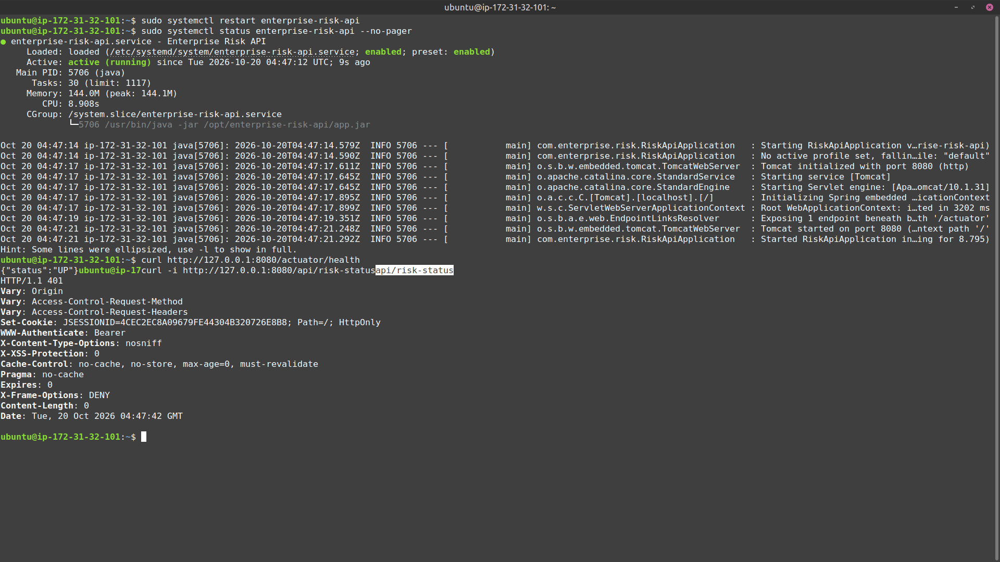
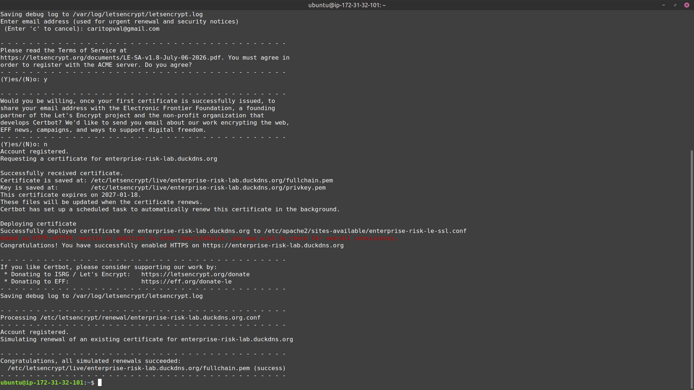

# Enterprise Risk Lab

Enterprise Risk Lab es una aplicación web segura que demuestra controles por capas para una API empresarial. Una aplicación de página única en React autentica a los usuarios con Auth0, obtiene un token de acceso y llama a una API de Spring Boot protegida como servidor de recursos OAuth 2.0. En producción, Apache sirve el frontend y actúa como proxy para el tráfico de la API mediante HTTPS.

> **Despliegue:** [https://enterprise-risk-lab.duckdns.org](https://enterprise-risk-lab.duckdns.org)

## Funcionamiento

Después de iniciar sesión, el frontend solicita un token de acceso a Auth0 y lo envía como `Authorization: Bearer <token>` a `GET /api/risk-status`. La API valida el emisor y la audiencia del JWT antes de devolver la respuesta de estado protegida:

```json
{
  "status": "protected",
  "subject": "authenticated-user-id",
  "control": "Validación de JWT y acceso autenticado"
}
```

Las solicitudes sin un token válido reciben `401 Unauthorized`; el endpoint de salud sigue siendo público para poder supervisar el servicio.

## Arquitectura

```text
Navegador
  │  Inicio de sesión universal de Auth0
  ▼
SPA React + Vite ── Token de acceso Bearer ──► Apache (HTTPS :443)
                                                │
                                                ├── sirve el frontend estático
                                                └── proxy inverso de /api/*
                                                        │
                                                        ▼
                                          API Spring Boot (127.0.0.1:8080)
                                          valida emisor y audiencia de Auth0
```

El backend se ubica deliberadamente detrás del proxy inverso en producción: el puerto `8080` no debe estar expuesto públicamente. Apache es el punto de entrada público, en los puertos `80` y `443`.

## Estructura del repositorio

```text
.
├── backend/       API Spring Boot 3 y configuración de Spring Security
├── frontend/      SPA React 19 + Vite e integración del cliente Auth0
├── deploy/        Host virtual Apache, unidad systemd y guía de configuración del servidor
└── docs/imgs/     Capturas de evidencia del despliegue
```

## Tecnología y controles de seguridad

| Capa | Implementación | Control proporcionado |
| --- | --- | --- |
| Frontend | React, Vite, `@auth0/auth0-react` | Delega el inicio de sesión en Auth0; la SPA nunca guarda un secreto de cliente. |
| Identidad | Auth0 | Autentica usuarios y emite tokens de acceso para la API. |
| API | Java 21, Spring Boot 3, Spring Security | Exige autenticación para `/api/**`. |
| Validación de token | Servidor de recursos OAuth 2.0 | Verifica la firma, el emisor de Auth0, la expiración y la audiencia requerida del token. |
| Acceso desde el navegador | Lista de orígenes permitidos por CORS | Solo los orígenes locales y de producción configurados pueden llamar a la API desde un navegador. |
| Perímetro | Proxy inverso Apache + Let's Encrypt | Termina HTTPS y mantiene el puerto de la aplicación fuera de Internet público. |
| Ejecución | Servicio systemd ejecutado como `riskapi` | Evita ejecutar la aplicación como root y proporciona registros del servicio. |

## Requisitos previos

- Java 21 para el backend.
- Node.js y npm para el frontend.
- Un tenant de Auth0 con permisos para crear una API, una aplicación SPA y un usuario de prueba.
- Para el despliegue: Ubuntu, Apache, Certbot y un nombre DNS que apunte al servidor.

## Ejecución local

### 1. Configurar Auth0

Crear lo siguiente en Auth0:

1. Una **API** llamada `Enterprise Risk Lab API`, con identificador `https://enterprise-risk-api` y algoritmo de firma **RS256**. Añadir el permiso `read:risk`.
2. Una **Single Page Application** llamada `Enterprise Risk Lab Frontend`.
3. Para la SPA, permitir los siguientes orígenes de callback, cierre de sesión y web:
   - `http://localhost:5173`
   - `https://enterprise-risk-lab.duckdns.org`
4. En **APIs** de la SPA, habilitar **User-Delegated Access** y conceder `read:risk`. Solo Client Access no es suficiente para este flujo de inicio de sesión de usuario.
5. Crear un usuario de base de datos para las pruebas.

### 2. Iniciar la API

```bash
cd backend
export AUTH0_ISSUER_URI="https://TU_TENANT.us.auth0.com/"
export AUTH0_AUDIENCE="https://enterprise-risk-api"
./mvnw spring-boot:run
```

La API escucha en `http://localhost:8080`. Comprobar el endpoint de salud sin autenticación con:

```bash
curl http://localhost:8080/actuator/health
```

La respuesta esperada es `{"status":"UP"}`. En cambio, la siguiente solicitud debe devolver `401` mientras el modo JWT esté habilitado:

```bash
curl -i http://localhost:8080/api/risk-status
```

### 3. Configurar e iniciar el frontend

```bash
cd frontend
cp .env.local.example .env.local
npm install
npm run dev
```

Asignar los siguientes valores en `frontend/.env.local` antes de abrir `http://localhost:5173`:

```dotenv
VITE_AUTH0_DOMAIN=tu-tenant.us.auth0.com
VITE_AUTH0_CLIENT_ID=tu_client_id_de_auth0_para_la_spa
VITE_AUTH0_AUDIENCE=https://enterprise-risk-api
VITE_API_URL=http://localhost:8080
```

Iniciar sesión y seleccionar **Llamar a la API protegida**. El frontend obtiene un token de forma silenciosa y muestra la respuesta de la API, sin imprimir el token de acceso.

## Variables de entorno

| Variable | Utilizada por | Propósito |
| --- | --- | --- |
| `AUTH0_ISSUER_URI` | Backend | Emisor del tenant de Auth0, incluida la barra final. |
| `AUTH0_AUDIENCE` | Backend | Identificador de la API esperado en el claim `aud` del token. |
| `VITE_AUTH0_DOMAIN` | Frontend | Dominio del tenant de Auth0. |
| `VITE_AUTH0_CLIENT_ID` | Frontend | Identificador público de la aplicación SPA de Auth0. |
| `VITE_AUTH0_AUDIENCE` | Frontend | Audiencia solicitada al obtener un token de acceso. |
| `VITE_API_URL` | Frontend | URL base de la API; usar la URL pública del sitio o una ruta del mismo origen en producción. |

Los valores predeterminados del backend son solo plantillas. Sustituir los valores de ejemplo de Auth0 y Duck DNS antes de desplegar. Mantener los secretos y valores específicos del entorno fuera de Git.

## Resumen del despliegue

La configuración para desplegar se encuentra en [`deploy/`](deploy/README-DEPLOY.md). A grandes rasgos:

1. Construir el JAR del backend con `./mvnw clean package` y el frontend con `npm run build`.
2. Copiar el JAR a `/opt/enterprise-risk-api/app.jar` y registrar [`enterprise-risk-api.service`](deploy/enterprise-risk-api.service) en systemd.
3. Copiar `frontend/dist/` a `/var/www/enterprise-risk-frontend`.
4. Habilitar el sitio Apache proporcionado en [`enterprise-risk.conf`](deploy/enterprise-risk.conf). Sirve la SPA y reenvía únicamente `/api/` a `127.0.0.1:8080`.
5. Apuntar el nombre de Duck DNS a la IP pública actual del servidor, abrir únicamente los puertos `80` y `443`, y utilizar Certbot para obtener un certificado.
6. Confirmar la renovación automática con `sudo certbot renew --dry-run`.

Al configurar las variables de despliegue, actualizar el tenant y dominio de ejemplo en la unidad systemd y configurar el origen CORS de producción. Después de modificar la unidad, ejecutar `sudo systemctl daemon-reload` y luego `sudo systemctl restart enterprise-risk-api`.

## Evidencias del despliegue

La API se ejecuta como un servicio systemd habilitado. La comprobación de salud devuelve `UP`, mientras que una solicitud sin autenticación al endpoint protegido se rechaza con `401` y `WWW-Authenticate: Bearer`.



Certbot obtuvo e instaló el certificado de Let's Encrypt para `enterprise-risk-lab.duckdns.org`; la renovación simulada registrada también finalizó correctamente.



## Lista de verificación

- [ ] `GET /actuator/health` devuelve `200` y `{"status":"UP"}`.
- [ ] `GET /api/risk-status` sin token devuelve `401`.
- [ ] Un usuario autenticado con Auth0 puede llamar correctamente a `/api/risk-status`.
- [ ] Se rechaza un token con un emisor o audiencia diferente.
- [ ] La aplicación está disponible mediante `https://enterprise-risk-lab.duckdns.org` con un certificado válido.
- [ ] El puerto `8080` no es accesible desde Internet público.
- [ ] `sudo certbot renew --dry-run` finaliza correctamente.

## Notas de seguridad

- No incluir en Git `.env.local`, credenciales del servidor, secretos de Auth0, tokens de acceso, claves privadas ni tokens de Duck DNS.
- Una SPA ejecutada en el navegador usa únicamente un Client ID de Auth0; nunca debe usar un secreto de cliente.
- CORS debe enumerar orígenes exactos en vez de usar un comodín para esta API autenticada.
- No registrar ni copiar manualmente los tokens Bearer. Deben tratarse como credenciales.
- La captura `docs/imgs/update_ip_duckdns` no se incluye intencionalmente porque contiene un token de Duck DNS. Revocar y reemplazar ese token antes de compartir la imagen fuera de un espacio de trabajo privado.
